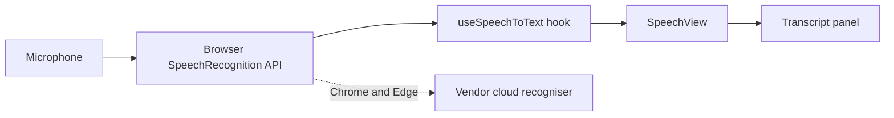

# VoiceLens

Live speech-to-text transcription in the browser. Start the microphone, speak,
and watch interim words appear in about a tenth of a second.

Live demo: https://pixytech.github.io/VoiceLens/

Part of the Pixytech app family, listed at https://portal.pixytech.com

## Status

VoiceLens currently uses the browser's built-in SpeechRecognition API. There is
no model download and no local processing. Local Whisper transcription is
planned. When it ships and the app runs on a local model, it will be renamed
VoiceLens-AI.

## Features

- Continuous transcription with interim (partial) and final text.
- Automatic reconnect on transient errors such as brief silence or a network
  blip.
- Transcript panel with a clear button.
- Language setting, defaulting to en-US.

## Architecture

### Overview



### Components

- **SpeechView** (`src/views/SpeechView.tsx`): the page. Start and stop
  controls, status, interim text and the transcript.
- **useSpeechToText** (`src/stt/useSpeechToText.ts`): a hook that owns the
  SpeechRecognition instance. It tracks status (idle, listening,
  reconnecting, error), accumulates final segments, exposes the current
  partial result and restarts recognition after transient errors such as
  `no-speech`, `network`, `aborted` and `audio-capture`.
- **SpeechPanel** (`src/stt/SpeechPanel.tsx`): a reusable transcript widget
  that uses the same hook.
- **Type declarations** (`src/stt/speech-recognition.d.ts`): typings for the
  prefixed browser API.

### Design decisions

- The recogniser is wrapped in a hook so the engine can be swapped. The
  planned Whisper integration replaces what the hook talks to (a worker with a
  local model) without changing the view.
- Recognition restarts automatically because the browser API stops itself
  after silence.

### Privacy

On Chrome and Edge the SpeechRecognition API streams audio to the browser
vendor's cloud recogniser. Audio does leave your device in this version. The
planned Whisper version will process audio locally.

### Limits

- Needs a browser that supports SpeechRecognition (Chrome or Edge).
- Needs microphone permission and a secure context (HTTPS or localhost).
- Accuracy depends on the browser's recogniser, accent and background noise.

## Develop

```
npm install
npm run dev
npm run build
```

## Deploy

Pushing to `main` runs `.github/workflows/deploy.yml`, which builds the app and
publishes it to GitHub Pages. In the repository settings, set Pages source to
GitHub Actions. The Vite `base` in `vite.config.ts` must match the repository
name.

`portal.json` lets the Pixytech portal list this app.

## Licence

MIT. See LICENSE.
